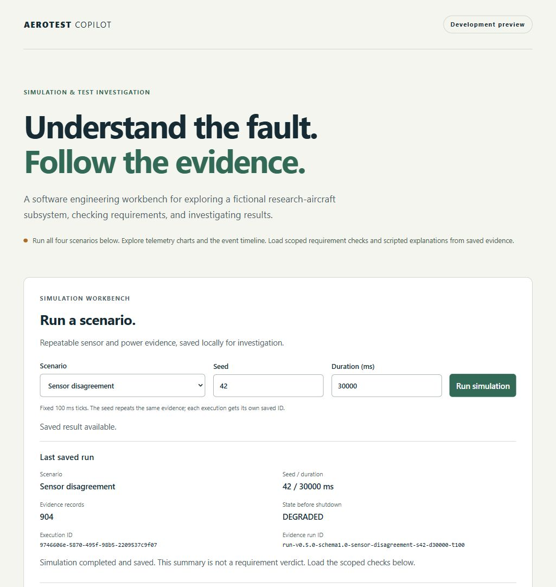

# AeroTest Copilot

**Simulation and evidence-based test investigation.**

A fictional civilian research-aircraft subsystem provides repeatable sensor and
battery scenarios. Independent Python checkers assess observed requirements, and
a scripted investigation assistant explains results using linked saved evidence.

**Educational simulation only. Not flight software or a validated physical model.**

## Current status: interactive simulation and scripted investigation

Implemented:
- Deterministic baseline, sensor-disagreement, missing-message and battery-degradation CLI runs with telemetry and state events.
- Low-battery thresholds with SAFE priority and nonnegative discharge telemetry.
- Sensor freshness detection with delayed-delivery evidence and missing-message faults.
- Persistent disagreement detection with strict amplitude and elapsed-time boundaries.
- Pure C++ state-transition function with startup gating, fault latching and shutdown priority.
- C++20 configuration validator with bounded JSON input and structured errors.
- Local SQLite storage for validated completed executions, with separate IDs and UTC timestamps.
- Bounded asynchronous Python runner with output validation and process cleanup.
- FastAPI endpoints to create and retrieve stored runs, plus health/config validation.
- Versioned check-report API combining scoped verdicts with resolvable evidence citations.
- Independent persistent-disagreement checker with threshold and duration evidence.
- Independent sensor-age checker with delayed-delivery and SAFE-latching evidence.
- Independent battery-response checker for low-power timing and SAFE latching.
- Independent transition-edge checker with PASS/FAIL/INCONCLUSIVE and event citations.
- Typed local investigation tools for bounded event queries, citation lookup and saved-run comparisons.
- Scripted investigation API and assistant adapter boundary with scoped verdicts and verified citations; live mode disabled.
- Shared acceptance cases and real C++/Python subprocess integration tests.
- Evaluation-only scripted regression cases and a reproducible verdict/citation report.
- React/TypeScript scenario, seed and duration controls with saved-run summaries and failure feedback.
- Sensor and battery sample charts with explicit units, time axes and missing-sample gaps.
- Filtered, paginated event timeline with expandable original evidence details.
- Scoped requirement-result cards with checker versions, explanations and validated evidence references.
- Scripted browser investigations with selectable requirements, resolved records and local tool activity.
- Pinned dependencies, checksum-verified C++ dependencies, setup and verification scripts.
- Optional Docker Compose setup with persistent SQLite storage and isolated HTTP verification.
- Requirements catalog, architecture notes, and a GitHub Actions workflow.

**Not implemented yet:** complete requirement-result evaluation, chatbot, live-model evaluations,
or a hosted interactive demo. The public repository is [JohnZargaryan/aerotest-copilot](https://github.com/JohnZargaryan/aerotest-copilot).
See [GitHub Actions](https://github.com/JohnZargaryan/aerotest-copilot/actions) for hosted check results; local results below are reported separately.

Latest local verification: 27 GoogleTest tests (including 20 shared configuration cases
and 192 state/signal combinations),
217 pytest tests, 14 frontend telemetry/report/investigation tests, lint, schema freshness, dependency check, TypeScript and production
build; 12 scripted evaluation cases (18 verdicts, 44 grounded citations). See [development log](docs/development-log.md) for actual results and limitations.

## See the app

[Read the engineering case study](docs/case-study.md), including a concrete fault
investigation, architecture, verified results and current limits.



[View the investigation, telemetry and original evidence screenshots](docs/screenshots.md).
These are static captures of a real local run in scripted mode.

[Watch the 65-second recorded walkthrough](docs/demo.md), with visible captions and
a transcript. It is an edited sequence of real browser captures in scripted mode.
The [$0 showcase plan](docs/hosting-review.md) combines these recorded assets, the
case study and local setup instructions.

## Start on Windows

Prerequisites: Git, Python 3.12, and Node.js (tested with 25.0.0 / npm 11.6.2).
This native setup requires no Docker, VS Code, API key, or full Visual Studio installation.

From the repository root in PowerShell:

```powershell
.\scripts\bootstrap-windows.ps1
.\scripts\verify.ps1
```

If Python is not on PATH, provide its executable:

```powershell
.\scripts\bootstrap-windows.ps1 -Python 'C:\path\to\python.exe'
```

Bootstrap downloads the pinned w64devkit toolkit into ignored `.tools/`, checks
its published SHA256 before extraction, creates `.venv/`, and installs locked
Python/npm dependencies. It does not change your system PATH. First CMake setup
downloads checksum-pinned GoogleTest and nlohmann/json archives.
Stop a running frontend preview before rerunning bootstrap: Windows can lock
native npm dependencies while the preview is using them.

Run the API:

```powershell
.\.venv\Scripts\python.exe -m uvicorn aerotest.app:app --app-dir backend --host 127.0.0.1 --port 8000
```

Open [API documentation](http://127.0.0.1:8000/docs). From another terminal:

```powershell
npm.cmd --prefix frontend run dev
```

Open the local URL printed by Vite. If your folder path contains `#`, the launcher
automatically builds and serves a preview instead of Vite hot reload (which cannot
resolve that path correctly). After edits, run `npm.cmd --prefix frontend run build`
in another terminal and refresh the browser. No project relocation is required.
Production preview:

```powershell
npm.cmd --prefix frontend run build
npm.cmd --prefix frontend run preview
```

Validate configuration directly (this does **not** run a simulation):

```powershell
'{"scenario_id":"healthy-baseline"}' | .\build\aerotest-sim.exe --validate-config
```

Run the healthy baseline (JSON output, no wall-clock waiting):

```powershell
'{"scenario_id":"healthy-baseline","seed":42,"duration_ms":30000}' | .\build\aerotest-sim.exe --run
```

Use `scenario_id` = `sensor-disagreement` for a repeatable sensor bias and DEGRADED transition.
See [sensor-disagreement behavior](docs/disagreement.md).

Use `scenario_id` = `missing-messages` for delayed/dropped samples and freshness transitions.
See [missing-message behavior](docs/missing-messages.md).

Use `scenario_id` = `battery-degradation` for a deterministic discharge.
See [battery behavior](docs/battery.md). All four declared scenarios now run.
See [baseline behavior and replay format](docs/baseline.md).

See [Run API](docs/run-api.md) for execution and retrieval examples.

See [Python runner](docs/runner.md) for local orchestration and error handling.

## Start with Docker (optional)

Prerequisites: Docker with a running Linux container engine and Compose v2.
On Windows, start Docker Desktop first. No host C++ compiler, Python, Node.js,
API key or paid service is needed to run the containers. Internet access is needed
for the first build. From the repository root:

```sh
docker compose up --build --detach --wait
```

Open [AeroTest Copilot](http://127.0.0.1:5173/). The frontend serves the built React
app and forwards `/api/` requests to the private API container; the API runs the
C++ simulator and saves executions in the Compose `runs` volume. Stop with
`docker compose down`; saved runs remain available when you start again.
See [Docker setup and verification](docs/docker.md) for port conflicts, build
inputs, persistence and isolated verification. This is a local setup, not a
public deployment.

## Linux / CI setup

Use Python 3.12, Node.js 25.0.0, a C++20 compiler (GCC 13+), CMake 4.4.3 and Ninja 1.13.2.

```sh
python3.12 -m venv .venv
. .venv/bin/activate
python -m pip install --require-hashes -r requirements.lock
python -m pip install cmake==4.4.3 ninja==1.13.2
cmake -S . -B build -G Ninja -DCMAKE_BUILD_TYPE=Debug
cmake --build build --parallel 2
ctest --test-dir build --output-on-failure
python -m pytest -q
python scripts/evaluate_scripted.py --check
ruff check backend scripts
python scripts/export_contracts.py --check
npm --prefix frontend ci --ignore-scripts
npm --prefix frontend run build
```

The initial Linux GitHub Actions run passed. Hosted results are available in
[GitHub Actions](https://github.com/JohnZargaryan/aerotest-copilot/actions);
the local verification above was performed on Windows.

## Design and learning

- [Scripted evaluation results](docs/scripted-evaluation.md)
- [Scripted investigation interface](docs/scripted-investigation.md)
- [Portfolio case study](docs/case-study.md)
- [Mobile layout and keyboard review](docs/usability-review.md)
- [Architecture diagram and public interfaces](docs/architecture.md)
- [Requirements catalog](docs/requirements.json)
- [State machine design](docs/state-machine.md)
- [Development roadmap](docs/backlog.md)
- [Interview guide and exercise](docs/interview-guide.md)
- [Dependency provenance](docs/dependencies.md)
- [Portfolio project card and preview](docs/project-card.md)
- [Portfolio presentation plan](docs/portfolio.md)

Source layout: `simulator/` for C++, `backend/` for Python, `frontend/` for React,
`contracts/` for shared schemas/cases. Runtime data and local test reports are ignored.

## Development

Implemented features, test results, and planned capabilities are documented separately.
