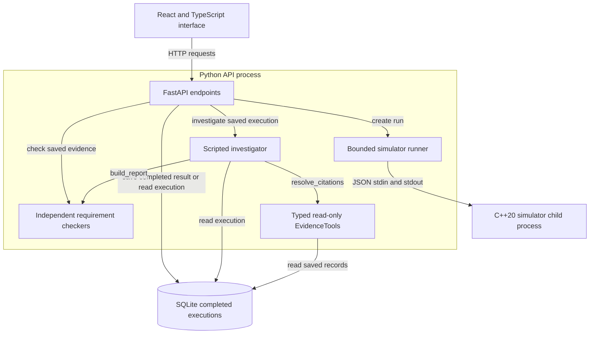

# Architecture and contracts

Reviewed against the implemented source on 2026-10-18.
The app is a local educational simulation with scripted investigation. Live-model
integration and free-form chat remain unavailable.

## Implemented call relationships

Arrows show calls/access, with responses omitted. The Python components share the
API process; checkers and tools are not separate network services. C++ returns
measurements and state events, not requirement verdicts. The runner returns a
validated completed result to the API; the API then saves it. Checks and scripted
findings are generated only when requested over saved evidence.

## Ownership and source

| Component | Responsibility | Implementation |
| --- | --- | --- |
| React interface | Scenario controls, saved summary, charts, timeline and validated results | [RunPanel](../frontend/src/RunPanel.tsx), [requirement results](../frontend/src/RequirementResults.tsx), [investigation panel](../frontend/src/InvestigationPanel.tsx) |
| FastAPI | Validate HTTP input, limit concurrent run requests and connect services | [app.py](../backend/aerotest/app.py) |
| Python runner | Launch the fixed binary, drain bounded output and validate record integrity | [runner.py](../backend/aerotest/runner.py) |
| C++ simulator | Fixed simulation ticks, seeded measurements, fault detection and operating policy | [simulation.cpp](../simulator/src/simulation.cpp), [state_machine.cpp](../simulator/src/state_machine.cpp) |
| SQLite store | Validated completed-result snapshots with invocation identity and UTC time | [storage.py](../backend/aerotest/storage.py) |
| Check report | Reconstruct scoped observed obligations with evidence IDs | [checkers.py](../backend/aerotest/checkers.py), [reports.py](../backend/aerotest/reports.py) |
| Evidence tools and narration | Typed read-only queries, citation resolution, comparisons and scripted findings | [investigation.py](../backend/aerotest/investigation.py), [assistant.py](../backend/aerotest/assistant.py), [adapters.py](../backend/aerotest/adapters.py) |

## Create, save and investigate

1. React submits a scenario configuration to FastAPI. Strict Pydantic validation
   accepts the four supported scenarios, a uint32 seed, 1000-120000 ms duration
   divisible by 100, and a fixed 100 ms step. C++ independently validates CLI input.
2. The API allows at most two concurrent create-run operations per application
   instance. Its worker thread owns a subprocess-capable event loop. The runner
   launches the repository's fixed simulator binary with `--run`, sends JSON and
   closes stdin; request data cannot choose an executable or shell command.
3. After process creation, execution is bounded to five seconds. Stdout is capped
   at 2000000 bytes and stderr at 65536 bytes. Timeout, cancellation or failure
   kills/waits for the direct child and settles stream tasks. Process creation and
   cleanup are outside that timeout; the trusted simulator has no child processes.
4. Output validation checks schema/simulator versions, request agreement, ordered
   ticks, contiguous sequences, evidence IDs and final shutdown. A validated
   completed result is revalidated and atomically saved in SQLite. Failed runs are
   not persisted. SQLite uses bound parameters and a five-second lock wait.
5. Repeating a normalized configuration preserves deterministic run/event IDs.
   Each save adds a new execution UUID and real UTC creation time outside the
   simulator result. Store reads revalidate snapshots; no update/delete API exists.
6. Check requests load saved evidence and compute four scoped results on demand:
   disagreement 001, freshness 002, power 003 and transition policy 006. Reports
   validate that their evidence IDs exist and leave 004/005 unassessed.
7. The scripted investigator loads the execution, calls the same report builder,
   selects all or one supported requirement and resolves cited records through
   EvidenceTools. It preserves verdicts, scope and unassessed requirements. At most
   20 citations are included per finding; longer chains retain the first/last 10
   and disclose omissions. Findings do not run a new simulation or modify storage.
8. React validates report identity and reference IDs, and checks investigation
   citation contents against saved records before displaying them. Charts and
   timeline show saved observations, not verdicts.

See [runner](runner.md), [storage](storage.md), [run API](run-api.md),
[scripted interface](scripted-investigation.md) and [recorded example](demo.md).

## Public interfaces

| Interface | Implemented behavior |
| --- | --- |
| `aerotest-sim --validate-config` | One JSON object through stdin EOF; normalized configuration on stdout, exit 0; invalid configuration returns structured JSON, exit 2 |
| `aerotest-sim --run` | All four declared scenarios; versioned completed result with normalized configuration, canonical run ID and ordered records |
| `GET /api/v1/health` | Run-API capability status; simulation and scripted investigation available; liveness does not prove writable storage or successful execution |
| `POST /api/v1/config/validate` | Normalized config or HTTP 422 validation details |
| `POST /api/v1/runs` | Execute and save a completed result; HTTP 201 with Location on success |
| `GET /api/v1/runs/{execution_id}` | Retrieve a saved execution or HTTP 404; malformed IDs return HTTP 422 |
| `GET /api/v1/runs/{execution_id}/checks` | Compute scoped verdicts/references from saved records |
| `GET /api/v1/runs/{execution_id}/investigation` | Scripted all/selected finding; optional `requirement_id` and `mode`; live mode returns HTTP 503 `LIVE_MODE_DISABLED` |
| `/docs` | Generated FastAPI API documentation |

CLI input is capped at 64 KiB. Pydantic is the JSON Schema source;
[schema export](../scripts/export_contracts.py) detects committed-schema drift.
Shared acceptance cases test strict integers: boolean, string and float tokens
(including 42.0) are rejected. JSON Schema alone cannot express that lexical rule.
Records carry explicit units, integer simulation time, sequence, state, component,
details, run ID and event ID. Catalog implementation status is distinct from a
runtime PASS/FAIL/INCONCLUSIVE result. Stored data currently requires compatible
simulator/result adapters; there is no database migration system.

## Local serving and container boundaries

Native development uses a loopback FastAPI process and Vite's `/api` proxy. The
workspace path containing `#` uses the existing build/preview fallback. Docker
Compose builds separate API and web targets: nginx serves static React files and
forwards `/api/` paths to the private API container. The API runs as UID 10001;
completed executions live in a named volume mounted at `/app/runtime`. Only the
web port is published, bound to `127.0.0.1`. FastAPI does not serve the built
frontend in this setup. See [Docker setup](docker.md) and [Compose](../compose.yaml).

## Evaluation and unfinished boundaries

The [12-case regression dataset](scripted-evaluation.md) is development-only.
Expected verdicts are not imported by application runtime or exposed by evidence
tools, and the container build excludes evaluation inputs. The dataset was reviewed
during development, not withheld as a blind external test. Citation grounding means
records match saved evidence; it does not demonstrate causal reasoning.

There are no live model calls, free-form agent loop, user accounts, authentication,
public deployment, failed-run history, retention system or migrations. Proposed
agent tool-call/model-request budgets are future design ideas, not implemented
controls. A [bounded mobile/keyboard review](usability-review.md) covers narrow
layouts, named scroll regions and keyboard flows in one browser; broader device
and accessibility coverage remains unverified. The
simulation is fictional civilian educational software, not certified flight software
or a validated physical model. These limits also appear in the
[portfolio case study](case-study.md).
