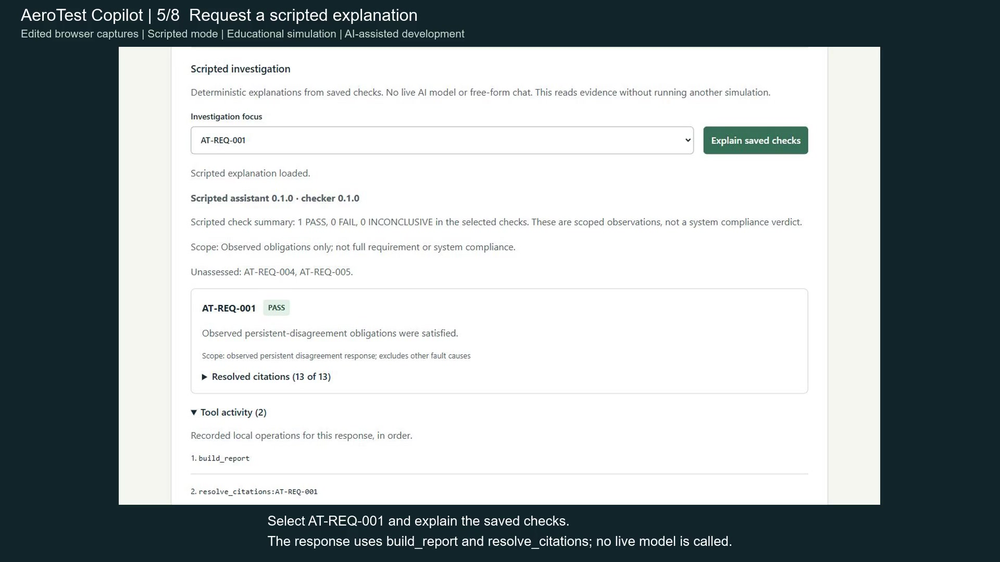

# Recorded scripted walkthrough

[](assets/demo/aerotest-walkthrough.mp4)

[Open the MP4](assets/demo/aerotest-walkthrough.mp4) ·
[Read the transcript](assets/demo/transcript.md) ·
[WebVTT captions](assets/demo/captions.vtt)

**65 seconds · 1920 x 1080 · H.264 · silent with visible captions.**
Download the MP4 from GitHub if the repository file view does not play it directly.
It also opens in a local browser or video player.

Prepared with OpenAI Codex assistance on 2026-10-17. The video is an edited sequence
of eight real browser captures from one local container-backed session. Hard cuts
and reading holds replace elapsed interaction time. It is not a continuous screen
recording or a performance measurement. Screenshots are cropped/scaled; headings
and captions are added outside the application view. UI text, original evidence and
verdicts are not rewritten. The assistant is deterministic scripted narration,
with no live model or free-form chat. No public application has been deployed.

## What the walkthrough shows

| Video time | Step |
| --- | --- |
| 00:00 | Introduce the educational simulation workbench |
| 00:05 | Choose sensor disagreement, seed 42, duration 30000 ms |
| 00:11 | Inspect the completed saved execution and its 904 records |
| 00:18 | Read scoped PASS/INCONCLUSIVE checks and unassessed requirements |
| 00:28 | Explain AT-REQ-001 and inspect the two recorded local tool operations |
| 00:38 | Open an original sensor-A citation at 2000 ms |
| 00:47 | Compare recorded sensor samples and the temporary sensor-B bias |
| 00:55 | Open Record 77: NOMINAL to DEGRADED at 2500 ms |

The run uses fixed 100 ms ticks and simulator 0.5.0. Scoped disagreement/transition
checks pass; unexercised sensor-age/power checks remain INCONCLUSIVE. AT-REQ-004/005
remain unassessed. One selected finding has 13 citations, each verified against
saved evidence. The opened sensor-A witness is 20043 mdegC at 2000 ms. The later
transition at 2500 ms responds to persistent disagreement; shutdown occurs at
30000 ms. A DEGRADED simulated state and a scoped checker PASS describe different
things. These observations do not establish overall compliance or physical validity.

The actual [saved execution](assets/demo/recorded-execution.json),
[check report](assets/demo/recorded-checks.json) and
[selected investigation](assets/demo/recorded-investigation.json) are preserved as
read-only recording evidence. They are not application inputs or evaluation keys.

## Reproduce the application steps

Follow the [native or Docker setup](../README.md). Select Sensor disagreement,
seed 42 and duration 30000 ms, then run the simulation. Load requirement checks;
select AT-REQ-001 and explain saved checks. Expand Tool activity and Resolved
citations. Inspect the sensor plot and expand Record 77 in the state-event timeline.
Your execution UUID and creation time will differ; repeatable evidence IDs remain
identical for this configuration. The video is a recorded local run, not a live
service that accepts inputs.

## Rebuild the video from preserved captures

The eight source JPEGs, exact capture timestamps, crop bounds, scenario identity,
step captions/durations and SHA256 hashes are preserved in
[walkthrough.json](assets/demo/walkthrough.json). The
[render report](assets/demo/render-report.json) records the actual encoder version,
render time, MP4 hash and successful complete decode. A local renderer validates
capture hashes before encoding, adds visible labels, writes matching WebVTT/plain
text and extracts a poster. It makes no network or model calls.

Supply FFmpeg with libx264/drawtext support and a local TrueType font:

```powershell
.\.venv\Scripts\python.exe scripts/render_demo.py --ffmpeg 'C:\path\to\ffmpeg.exe' --font 'C:\Windows\Fonts\arial.ttf'
```

Python 3.12 and FFmpeg are authoring tools, not application runtime dependencies.
No font or encoder executable is redistributed in the repository. The verified
Windows render used the checksum-checked imageio-ffmpeg 0.6.0 PyPI wheel, which
contains FFmpeg 7.1; its wheel hash is in the manifest. Output byte identity may
vary with encoder/font versions. A full decode and separate stream inspection
confirmed 65 seconds, 1560 frames, 24 fps, H.264/yuv420p and no audio. Browser playback
was checked locally; other browsers and mobile layouts remain unverified.

The video, poster, captions and transcript are available for a separately authorized
portfolio integration. Website edits and hosting remain separate work.
