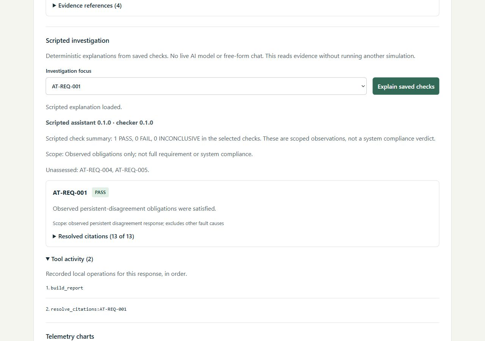

# Final showcase verification

**Verified on 2026-10-23: the local scripted application and repository presentation
assets are ready for portfolio integration.** Website integration and public
application hosting require separate authorization. This sign-off covers the
implemented educational scope below; it is not flight-software qualification,
physical-model validation or a production-service assessment.

## Scope completed

- Four deterministic sensor/battery scenarios through the C++20 simulator.
- Bounded Python execution, validated completed-run storage and independent scoped
  requirement checks with original evidence references.
- React controls, telemetry, timeline, check results and scripted investigations.
- Native setup, isolated Docker verification and persistence checks.
- Case study, current architecture source, dated mobile/keyboard review, real
  screenshots, captioned recording, project-card bundle and $0 hosting review.

Live-model integration/free-form chat, runtime 004/005 verdicts, internet backend
hosting and actual portfolio-site integration remain outside this prepared
showcase. Configuration and replay have tests; 004/005 are still explicitly
unassessed in runtime reports. The [hosting decision](hosting-review.md) recommends
static presentation assets with local setup for fresh simulations.

## Actual verification results

Source checked: `e25f7ca389ef92b7271651872d314763cd486089`. Completion documentation
is added after that verification; application source and dependencies are unchanged.
Machine-readable details: [results.json](assets/final-verification/results.json).

| Check | Result |
| --- | --- |
| Native C++ GoogleTest | 27 passed; no failures/errors in JUnit report |
| Python/integration pytest | 217 passed; no failures/errors in JUnit report |
| Frontend regression tests | 14 passed |
| Scripted regression evaluation | 12/12 cases; 18/18 verdict matches; 44/44 grounded citations |
| Ruff, schema freshness, dependency compatibility | Passed |
| TypeScript and production build | Passed |
| Generated project card and source-image provenance | Passed |
| Isolated Docker HTTP verification | Four scenarios, reports and original citations passed |
| Container replacement | Four saved executions retrieved unchanged after replacement |
| Presentation/source hash audit | 34 comparisons passed before completion notes |
| Existing local Markdown paths | 114 references resolved before completion notes |
| Recorded MP4 | Full FFmpeg decode passed; browser reached 65 seconds and ended without a media error |
| Captions | Eight WebVTT cues parsed; visible captions retained in video |

Native reports and full logs remain in ignored `artifacts/`; their hashes are in
the results file. Hosted CI produces its own reports and is reported separately.
Repeat native checks with `scripts/verify.ps1`; run
`python scripts/verify_docker.py` with a running Docker Linux engine for the isolated
container checks. See the [README](../README.md) and [Docker guide](docker.md) for
prerequisites. No new external credentials are required.

## Final browser sample

Used a new isolated container-backed execution with Sensor disagreement, seed 42,
30000 ms duration and 100 ms ticks. Execution ID:
`d721191b-0d13-4f34-9617-8db1fd9f8824`.

- Saved 904 records; state before shutdown was DEGRADED.
- Report: 001/006 PASS, 002/003 INCONCLUSIVE, 004/005 unassessed.
- Selected 001 explanation resolved 13 citations and recorded `build_report`
  followed by `resolve_citations:AT-REQ-001`.
- Opened the original sensor-A record 62: 20043 mdegC at 2000 ms. Opened Record 77:
  NOMINAL to DEGRADED at 2500 ms.
- At a 390-pixel phone viewport, document client/scroll widths both measured 375;
  plot content retained about 640 pixels and chart/table regions scrolled with
  arrow keys. At 1280 pixels, document client/scroll widths both measured 1265.
- Copied card HTML/JPEG loaded in a local browser, with correct three public
  destinations and visible keyboard focus. Its existing four-width review remains
  separately dated in the [card handoff](project-card.md).
- Copied MP4/poster/captions loaded in a temporary local HTML5 player. Playback
  reached 65 seconds, ended and reported no error at 1920 x 1080. The recording
  already has burned-in captions, so the optional WebVTT track was left disabled
  during this playback to avoid displaying the same text twice.

The image is a cropped real browser state from this verification. UI text,
verdicts and evidence were not edited. It is separate from the older demonstration
recording and original capture provenance. Temporary preview services were stopped,
browser sizing restored and only disposable test containers/volumes removed.

## Warnings and coverage limits

Existing Starlette/httpx and AnyIO deprecation warnings remain. Pytest could not
write its optional cache under Windows permissions; all tests and JUnit reports
completed. Vite still warns about `#` in the workspace path; its production build
and served assets passed. These warnings are recorded, not silently counted as
failures or fixed by changing pinned dependencies.

This used the existing pinned local environment and Docker build cache, not a
fresh-machine bootstrap rehearsal. Browser checks used one Windows embedded browser
and the stated viewport sizes.
They do not establish physical-device, all-browser, screen-reader, high-zoom or
contrast conformance. The architecture call diagram was reviewed against source;
no new rendered-Mermaid layout certification is claimed. Regression cases remain
development-reviewed rather than a blind external holdout. Grounded citations show
record agreement, not live-model accuracy or causal reasoning. No overall
requirements-compliance, physical fidelity or recruiter-impact metric is claimed.

## Publication handoff

The [project card](project-card.md), [engineering case study](case-study.md),
[recorded demo](demo.md), [screenshots](screenshots.md), source and local setup are
the ready-to-use inputs. The [$0 review](hosting-review.md) records the recommended
static presentation and backend limits. Adapt and verify those assets on the actual
portfolio only after that separate work is authorized; keep recorded-mode labels,
captions/transcript and scoped-verdict boundaries. No site files, hosting account,
DNS settings, paid services or public application deployment were changed here.
