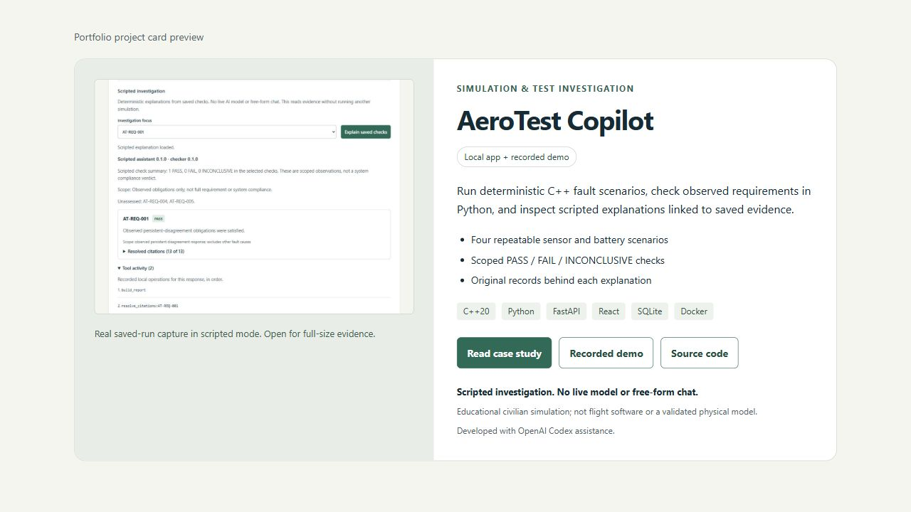

# Portfolio project card

Prepared with OpenAI Codex assistance. This repository contains the card copy,
source image and a standalone responsive preview. The portfolio site is unchanged;
site-specific styling/integration remains separate. The [$0 hosting review](hosting-review.md)
documents the recommended static presentation route and backend limits.

## Ready-to-use content

**AeroTest Copilot** — Simulation & test investigation

Run deterministic C++ fault scenarios, check observed requirements in Python, and
inspect scripted explanations linked to saved evidence.

- Four repeatable sensor and battery scenarios.
- Scoped PASS / FAIL / INCONCLUSIVE checks.
- Original records behind each explanation.

Technologies: C++20, Python, FastAPI, React, SQLite and Docker.
Availability: **Local app + recorded demo**.

Keep these disclosures with the card: scripted investigation, no live model or
free-form chat; educational civilian simulation, not flight software or a validated
physical model; developed with OpenAI Codex assistance.

The canonical fields are in [project-card.json](project-card.json). The generated
[HTML preview](project-card.html) uses those fields and the existing, unchanged
[real investigation screenshot](assets/sensor-investigation.jpg). Its SHA256 matches
[the capture provenance](assets/screenshots.json). The thumbnail opens the original
1025 x 755 image so small screenshot text can be inspected at full size. Alt text
identifies the selected finding, resolved citations and recorded local tools.

## Destinations and integration handoff

| Visible action | Destination | Meaning |
| --- | --- | --- |
| Read case study | [Engineering case study](case-study.md) | Problem, architecture, concrete evidence, tests and limits |
| Recorded demo | [Captioned walkthrough](demo.md) | Edited real browser captures, captions and transcript |
| Source code | [Public repository](https://github.com/JohnZargaryan/aerotest-copilot) | Code and local setup |

The preview uses public GitHub destinations for these actions. There is no live-demo
link. All destination files were checked locally; no application host is assumed.
When integrating later, copy the source JPEG and canonical copy into the site's
asset/component conventions, adapt the layout to its existing design, retain the
mode/educational/assistance disclosures, and verify the final site's navigation,
image path, narrow-screen layout and keyboard order. This preview does not establish
compatibility with a site that has not been edited or tested.

The HTML is a self-contained document except for its relative JPEG. Open it in a
browser alongside the repository's docs folder. GitHub's file page shows HTML source;
it does not execute this preview. An optional local-only preview from the repo root:

```powershell
.\.venv\Scripts\python.exe -m http.server 15174 --bind 127.0.0.1 --directory docs
```

Then open `http://127.0.0.1:15174/project-card.html`. No Docker, API server, key,
external font, analytics, JavaScript or paid service is required for the card.

## Authoring and verification

Edit the JSON for copy or the [template](../scripts/project-card-template.html) for
layout, then regenerate with Python 3.12 and its standard library:

```powershell
.\.venv\Scripts\python.exe scripts/render_project_card.py
.\.venv\Scripts\python.exe scripts/render_project_card.py --check
```

The authoring script escapes text/attributes, verifies the screenshot SHA256 against
capture provenance, checks local repository destinations and checks generated HTML
freshness. The same read-only check is included in native verification and CI.
It does not upload files, run the simulator or deploy anything.

Reviewed on 2026-10-20 in the Windows Codex in-app browser at requested widths 320,
390, 768 and 1280. The card fit without horizontal document overflow, the image
loaded, action labels wrapped within the card and focus remained visible. Tab
reached the screenshot, case study, demo and source links in order; Shift+Tab moved
back. Enter opened the full-size screenshot and Back returned to the card. Link
hrefs matched their intended public destinations. This is a one-browser viewport/
keyboard review, not a physical-device, screen-reader or contrast conformance audit.



[Phone preview](assets/project-card/mobile-preview.jpg) ·
[Review dimensions, source and image hashes](assets/project-card/review.json)

These are screenshots of the standalone presentation card, not a deployed portfolio
page or a new simulation execution. Regenerate/review captures if copy or layout
changes. The original source screenshot retains its own dated provenance.
