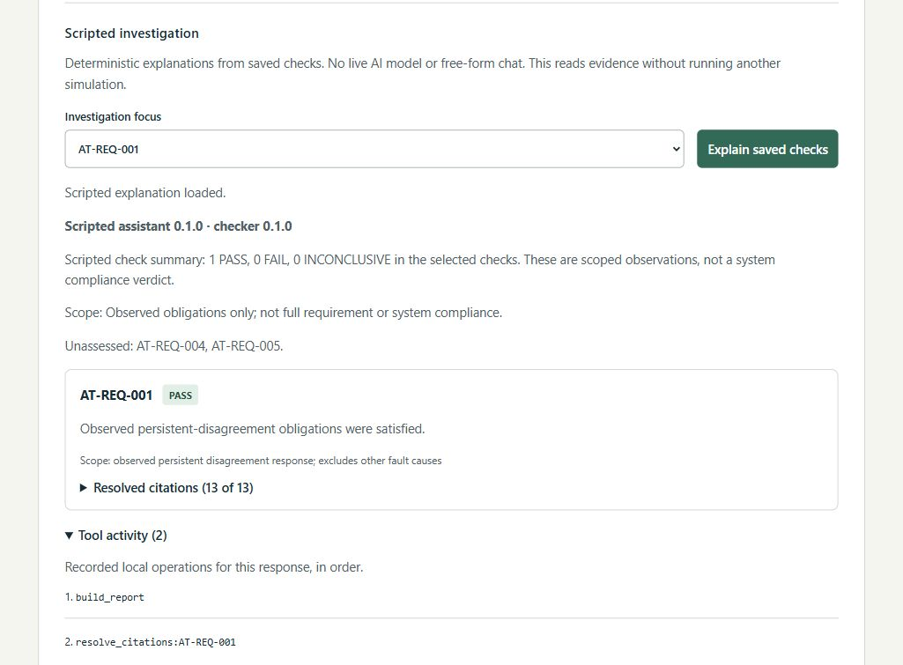
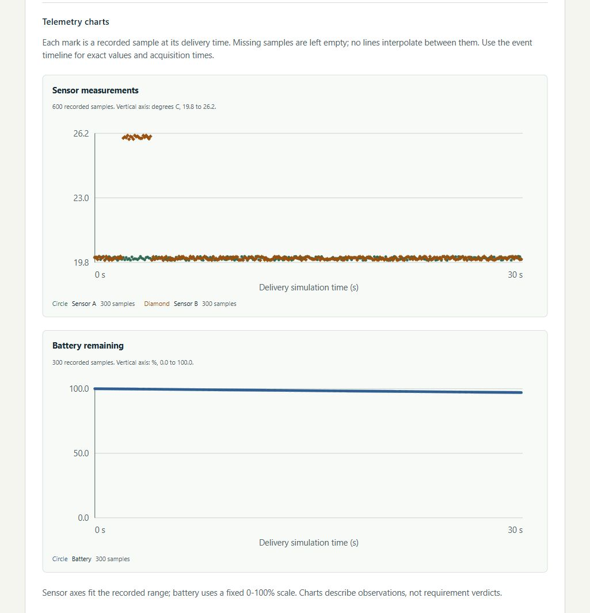
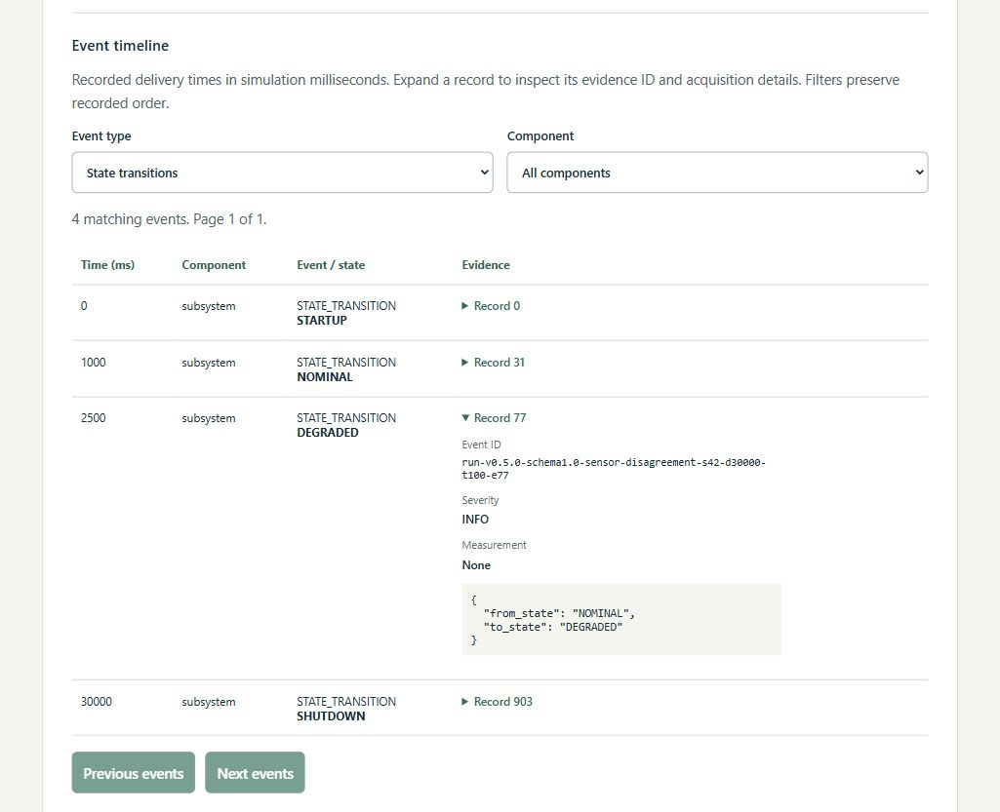

# Screenshots of a real investigation

Captured and verified with OpenAI Codex assistance on 2026-10-13 (America/Los_Angeles).
These are static browser screenshots from a real local C++ execution, not mockups,
a hosted application or a live AI demo. The native API used isolated SQLite storage.
Only page regions were cropped; UI text, verdicts and evidence were not altered.
Capture metadata, source revision, image dimensions and SHA256 hashes are recorded
in [screenshots.json](assets/screenshots.json).

All four images show the same sensor-disagreement execution: seed 42, duration
30000 ms, fixed 100 ms ticks, simulator 0.5.0. It contains 904 evidence records.
The execution ID identifies this saved instance; rerunning the configuration creates
a new execution ID with the same deterministic evidence run ID.

## Scenario and saved result

A successful run means the simulation completed and was saved. DEGRADED is the
observed subsystem state before shutdown, not a test failure or a compliance verdict.

## Selected scripted investigation

The observed disagreement response passes AT-REQ-001's scoped check. The selected
summary contains one finding, not all requirements. Unassessed 004/005 remain
explicit. This is deterministic scripted narration; it makes no live model call.
The 13 returned citations were checked against the original saved records.

## Recorded telemetry

Sensor B is biased between 2000 and 3900 ms. The charts use delivery simulation time,
explicit units and recorded marks. Sensor axes fit their recorded range; battery
uses a fixed 0-100 percent range. They show observations, not requirement verdicts.

## Original transition evidence

Record 77 preserves the exact event ID and NOMINAL-to-DEGRADED details at 2500 ms.
The state remains latched after the bias ends and the run shuts down at 30000 ms.
The saved record was checked against this displayed witness.

## Reproduce the views

Start the app using the [native or Docker instructions](../README.md). Select
Sensor disagreement, retain seed 42 and duration 30000, then choose Run simulation.
Load requirement checks. Select AT-REQ-001 under Investigation focus and choose
Explain saved checks; expand Tool activity. Scroll to Telemetry charts and then
the state-event timeline; expand Record 77. Your saved execution ID and creation
time will differ from this capture.

The same saved report also contains AT-REQ-006 PASS and AT-REQ-002/003 INCONCLUSIVE;
unexercised fault conditions are not passing checks. The app remains an educational
civilian simulation, not flight software or a validated physical model.

These desktop captures can support a repository walkthrough or a separately
authorized portfolio integration. A separate [recorded walkthrough](demo.md) and
[bounded mobile/keyboard review](usability-review.md) are now available. These
desktop screenshots alone do not establish those checks.
