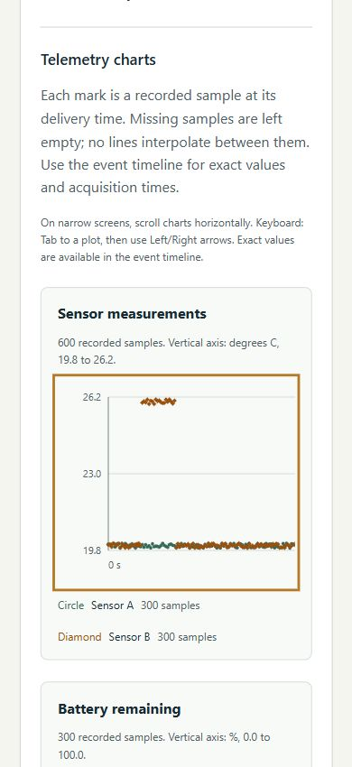
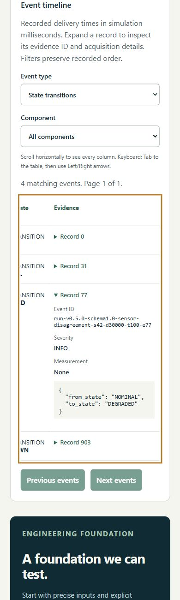

# Mobile layout and keyboard review

Reviewed locally on 2026-10-19 with OpenAI Codex assistance, using the Windows
Codex in-app browser and an isolated Docker build. This is a bounded manual
application review, not a WCAG conformance audit or physical-device certification.

## Changes and observed results

- Previously a 640-unit chart shrank to about 177 CSS pixels at the smallest
  tested width, making axis labels too small. Plots now retain a minimum width
  of 640 CSS pixels inside horizontally scrollable regions. Legends, units and
  the exact-value timeline remain available outside/alongside the plot.
- Each chart and the event table now has a named, focusable scroll region and
  visible instructions. Tab reaches the region; Left/Right arrows scroll it.
  The table previously skipped directly from its filters to record disclosures.
- Simulation, check and investigation buttons keep keyboard focus during and
  after loading. They expose `aria-disabled` while existing pending-request guards
  prevent re-entry; configuration inputs still disable during their request.
  Previously native disabling moved active focus to the document body.

| Requested viewport | Observed window / document client width | Document scroll width | Result |
| --- | --- | --- | --- |
| 320 x 800 | 320 / 305 | 305 | One-column form; long identifiers/citations wrap |
| 390 x 844 | 390 / 375 | 375 | One-column form; chart/table scroll inside their regions |
| 768 x 1024 | 769 / 753 | 753 | Two-column form; no horizontal page overflow |
| 1280 x 900 | 1280 / 1265 | 1265 | Four-column form; charts and table fit |

Dimensions are CSS pixels reported by the embedded browser. Its scrollbar and
viewport normalization explain the difference between requested, window and client
widths. The narrowest plots had 177 visible pixels and 640 content pixels; the
narrowest table had 215 visible pixels and 530 content pixels. Horizontal scrolling
is intentional for these data views. It does not widen the whole page.

## Reproduce the keyboard checks

Start the app using the [setup instructions](../README.md). Retain seed 42 and
use Sensor disagreement with duration 30000 ms. The review exercised:

1. Tab/Shift+Tab through scenario, seed, duration and action controls. Home/Down
   select the scenario. Submitting duration 1050 focuses the invalid duration
   input with a native step-validation message; no saved result appears.
2. Correct duration to 30000 and activate Run simulation with Enter. The button
   remains focused with a visible outline while loading and after saving.
3. Tab to Load requirement checks and activate it. Expand/collapse evidence
   references with Enter. Select AT-REQ-001 for the scripted investigation and
   activate Explain saved checks. Expand citations with Enter and tool activity
   with Space. Long evidence IDs and expanded JSON wrap within the page.
4. Tab to each chart and press Right. Both regions moved from scroll position
   0 to 40; the plot labels retained their size and the focus outline was visible.
   Tab proceeds to the timeline filters without a focus trap.
5. Tab from the Component filter to Saved event table. Right moves the table
   horizontally; Tab then reaches Record 0. Enter opens/closes its evidence.
   Open Record 77 to inspect the original NOMINAL-to-DEGRADED transition.
6. Sensor samples + Battery produces 0 matching events and an explicit empty
   state. Sensor samples + Sensor A produces 300 events across 15 pages. Enter
   on Next events reaches page 2; Previous events returns to page 1. Changing
   filters resets the page. Native disabled pagination controls skip tab order.

The successful capture execution was `1132a03e-d7ca-4628-b75b-57e51c46d3bb`:
904 records, DEGRADED before shutdown, 001/006 PASS, 002/003 INCONCLUSIVE and
004/005 unassessed. Selected 001 narration had 13 resolved citations. Record 77
was the 2500 ms transition. A reproduction creates a new execution UUID.

## Interrupted-request check

Stopped only the disposable test API while keeping its frontend open. Check,
investigation and simulation requests each reached their timeout/error message.
The prior execution `36db4502-f8db-4a3b-9f09-3c35ebfcc973`, report and explanation
remained visible. Focus stayed on the last activated simulation button; completing
other requests did not take focus away. Restarted the API and retried using Enter:
the successful execution above replaced the saved summary, then checks and selected
investigation loaded successfully. These are local recovery checks, not latency
measurements. The ordinary application database was not used.

## Capture evidence

The chart image shows the left portion of a horizontally scrollable plot at a
390-pixel requested viewport; the remaining time range is reached by scrolling.

The table image shows its right-hand evidence column after keyboard scrolling;
the first columns are outside this scroll position. Captures are cropped page
regions with no edited UI text. [Review metadata](assets/usability/review.json)
records the base revision, changed-source hashes, dimensions, execution IDs,
capture completion time and JPEG hashes.

## Verification and limits

All 14 frontend regression tests, TypeScript checking and the production build
passed. Both rebuilt Docker services became healthy. The existing Vite warning
about the workspace path containing `#` remains non-fatal. Backend/simulator
source and dependencies did not change; their native suites were not rerun for
this UI change. Hosted foundation/container results are reported separately.

This review covers one browser, emulated viewport sizes and the described saved
scenario. It does not establish physical touch-device behavior, screen-reader
output, other browser engines, high-zoom behavior, a contrast audit or general
accessibility conformance. SVG sample tooltips are not individual keyboard stops;
use the event timeline for exact recorded values. The video recording's separate
browser/device playback limits are unchanged. No paid service, live model,
application deployment or portfolio-site change was added.
